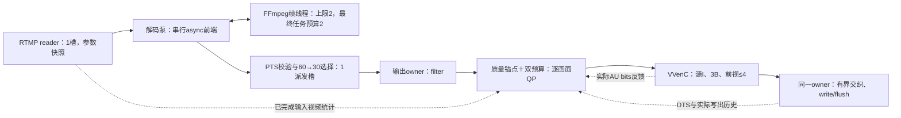

# 有界解码泵与受限CRF第二批（2026-10-18）

本轮在既有原生CQF基线上实现实验性的质量锚点、编码前双预算和逐AU码量反馈，并减少reader/decoder前端排队。1100kbps按秒级视频码量处理，不是每帧硬限额；源I跟随、3B和最多4张540p编码画面前视保留。测量完成与合同通过分开报告。

最终speed8/解码预算2的两次完整复测，中段29.997/29.974fps、最大281.885/280.851ms、0超时，写出滚动1秒视频峰值最高987.432kbps；源I、3B、实际最大未来画面3保持。第一轮全部1781帧PSNR average 30.367dB、VMAF 69.812。当前样本满足声明合同，但相对保留RDOQ/ALF的对照有约4.2分VMAF代价；两轮60秒不是全内容最坏值保证。

## 之前的async解码确实一直启用

服务此前已经使用fork的`avcodec_async_create/send_packet/receive_frame`、`FF_THREAD_FRAME`和自适应任务预算，并没有切回原版同步send/receive。直接输出时，前台owner还要同步执行filter/编码/mux，编码繁忙会影响它继续喂包、取解码结果。异步API本身不消除H.264/HEVC显示重排、参考依赖或下游背压。

新增`reader_queue_capacity=1..8`（默认8），读下一包前先等名额，避免先读后额外持包；默认owner每轮至多收一张解码帧再继续喂包。前期对照使用reader1、async queue1、max_threads2/min_threads1/budget_slots1：仍分配帧线程，同时在途任务约束为1。最终M窗口在其余条件不变时改为min_threads2/budget_slots2，复用同一批已分配线程，仍是有界小队列。

可选`decoder_pump=true`（默认false，仅直接输出）把async前端send/receive/stats串行放在独立线程，只用一个派发槽及既有有界async队列。只有原输出owner处理audio hooks、filter、编码及mux；音频参数仍是reader的不可变快照。EOF/取消先join泵和reader，再释放async，正常路径完整排空。

泵逐帧校验PTS、保持显示序号，在follow_source且没有过载策略时，把既有整数降帧放在解码后、派发前。源I、首帧、指定SEI仍保护，不增加丢帧；每张保留画面在派发槽里也被在途跟踪。新opaque_ref副本持有原始stamp引用，避免提前触发packet tracking析构。`async_ready_ms`与`decoded_dispatch_queue_ms`用于区分async前端交付与派发；派发等待已包含在setup/dispatch总阶段里，不能重复相加。所有最终视频时延仍截止实际write/flush。

启用泵时的所有权如下；图中的预算历史不持有图像：

## 双预算与QP通路

新模式`rate_control=constrained_crf`，`crf`为0–63整数质量锚点（默认32），并非x264/x265 CRF刻度。单个直接live VVenC、follow_source、output_fps与未来画面守卫为必要条件，不接受qp/bitrate或outputs数组。`source_rate_limit=true`和显式maxrate可分别启用或同时启用；至少一项，源策略要求plain RTMP及network_trace。既有CQF/bitrate路径不变。

稀疏10-bit亮度梯度和历史运动活动给出对数质量调整，保留QPA和3B层级；预算取过去1秒已经完成的RTMP视频消息统计与固定maxrate的较小值。控制器用约1秒的DTS/实际写出历史和在途预测预留选QP，实际AU bits替换预测并更新I/P/B码量模型，写出后进入实际窗口。预测目标82%、窗口余量95%，I/P/B权重6/3.2/0.2。质量基准以下不主动花光码率；预算紧张时提高QP。没有发送等待、重编码或额外丢帧，QP饱和也不掩盖违规。

每张画面的delta经`naki_qp_offset`→`vvencYUVBuffer.liveQpOffset`→PicShared，在该画面的QP/QPA/lambda计算之前应用，不在重排中修改全局QP。返回`live_slice_qp`是实际slice QP，CTU QPA仍可细调。`VVENC_LIVE_QP_OFFSET_VERSION=1`扩展YUV/AU结构，客户端必须使用匹配SDK重编；非零delta只允许验证过的live CQF poll路径。

审计对两条规则独立记账。第二批声明1,100,000bit预算容量：绝对桶有最多一个窗口的启动额度；源桶首次写出只根据已收到的过去1秒源视频初始化，未收到的消息不授信。精确DTS/实际写出滚动1秒峰值仍独立检查。旧原生CQF的初始0额度合同不变，旧结果没有重标。`enforcement=true`表示反馈控制器启用，是否达到目标仍看conformance；这不是成熟CRF或严格VBV保证。

## 编码搜索对照

默认`live_3b_2s`和`faster`不改。新增CQF实验profile：

| profile | 与默认faster的差异 |
| --- | --- |
| `live_3b_2s_qt8` | I/P/B最小QT改8、chroma4；SearchRange64、MinSearchWindow32、FastIntraTools2 |
| `live_3b_2s_qt16` | 同上，但最小QT16、chroma8 |
| `live_3b_2s_rdoq0` | qt16基础上关闭RDOQ、SelectiveRDOQ，保留ALF、CCALF |
| `live_3b_2s_speed` | qt16基础上关闭RDOQ、SelectiveRDOQ、ALF、CCALF |

四者仍保留源I、3B、QPA、过去参考MCTF、禁用未来MCTF/RC lookahead/跨帧并行。减少搜索与滤波会改变质量，不能只引用速度。BUSY_WAIT_TIME=0显式用于本轮，服务默认不覆盖该环境。

## 运行身份

| 项目 | 身份 |
| --- | --- |
| 父库依赖pin | `12857f7458fd5d676fdab046f266a6135d6c807e` |
| FFmpeg | `a68a28bfe0f4bb8f63ccf3baa87f9974fdc289d8` |
| VVenC | `1515ef331ca71fdc5b9ae9b88f1c8fef00bfd54d` |
| dependency key | `d6a2d4cab3580acb8e8e6fe8` |
| SDK identity | `4db4c88c5074768308ec429f20e9b239721396651c96caa660e326b1b7422d47` |
| VVenC Build ID | `3ac4101b35b5208e61c8b4b630ee4e636a5b262b` |
| J/K窗口应用/工具/测试源码摘要 | `fe7c24151714b5729ecdb47293f4967b237d7a23e75f1ff0bab84684aec0b0d2` |
| L及以后窗口源码摘要（增加rdoq0对照） | `bfcad9a652980e5ebc53e76f9bd259f56ea0f546d00050ec0f4b9be9e5c2ec3d` |

两库修改分别先提交推送，再更新父gitlink。匹配DWARF在`out/constrained-crf-20261018-b/symbols-vvenc`和`symbols-ffmpeg`，manifest绑定pins/key/Build ID；`dependency-provenance.json`为入口。应用构建日志分别为`build-app-speed-j.log`与`build-app-rdoq0-l.log`。库内部JSON保留，服务仍用yyjson、evhttp与libcurl。

环境与输入沿用[第一批](validation-live-budget-20261018.md)：Ryzen 7 9700X、16逻辑CPU、Ubuntu WSL2，直接loopback RTMP拉流→转码→推流→独立capture；无中转服务器或显示端。60秒复杂树林1080p60、GOP120输入SHA-256为`2e81a557fc8b1a6fb8634b2018a98752b3ea86d078a3ecb1b6252c60983ca2e7`。有限源目标1770张后API停止并收尾，源PTS留1秒预滚，输出960×540名义30fps。背压仍可能移到内核/源端，因此同时报告实际FPS；不是source-to-screen或目标机容量证据。

## 筛选与失败尝试

下表均为前12秒scout，不能代替完整素材最坏值；短样本中去头尾各5秒的FPS窗口很窄，也不能用31.74fps宣称实时容量。

| 阶段 | 实际中段FPS | 平均 / 最大读取→写出ms | 原始目录 |
| --- | ---: | ---: | --- |
| 只收紧reader/decoder，原生CQF | 22.822 | 280.533 / 506.023 | `out/rtmp-bench-hf6f4xcn` |
| 首版双预算，参考权重不足 | 19.177 | 321.019 / 589.935 | `out/rtmp-bench-8afubjdp` |
| 单槽解码泵、原权重 | 19.433 | 346.794 / 610.099 | `out/rtmp-bench-aiwcii3x` |
| 派发前降帧、原权重 | 19.703 | 347.212 / 616.854 | `out/rtmp-bench-eirjhwvl` |
| I/P/B分配改为6/3.2/0.2 | 23.578 | 286.488 / 503.045 | `out/rtmp-bench-q2ej4p05` |
| qt8 | 24.526 | 279.722 / 475.220 | `out/rtmp-bench-a2700l73` |
| qt16 | 28.828 | 222.452 / 391.408 | `out/rtmp-bench-9ztatxoe` |
| speed，8编码线程 | 31.743 | 157.082 / 276.720 | `out/rtmp-bench-l6fj538t` |
| speed，4编码线程 | 29.361 | 163.143 / 279.545 | `out/rtmp-bench-mza7xxne` |

收紧队列后的输入排队均值约29ms。仅加泵/提前丢掉原本要降帧的画面没有改善该段实际瓶颈，不能将最终收益都归于泵。首版预算把P帧平均压到5.7KB、B帧给到3.2KB，对照原生CQF约10.9KB/1.1KB；改善参考分配后速度才恢复。减少QT搜索并关闭昂贵工具才使短测所有交付帧低于300ms。全程不放松3B或前视守卫。

首轮检查B因新增native测试未登记到inventory而失败；C的新增配置用例缺少source_all，被原有策略校验正确拒绝。登记并修正用例后D/F/G/H/I/J窗口各自检查通过，不能拼成一个窗口。符号导出首次因WSL Git status超30秒失败，改由Windows Git验证相同release-key后成功，失败日志保留。源码、媒体和结果均使用独立目录，未覆盖历史失败证据。

## 源码率动态检查

另制12秒320×180p60/GOP120合成源，4–8秒启用噪声，转为540p30；这是功能场景，不混入树林性能。源生成命令在`out/constrained-crf-20261018-b/rate-switch-command.json`，输入只在out中。

`out/checks-crf-rate-switch-20261018-j/summary.json`→`out/rtmp-bench-j60qtw1j`：337张实际出流，全部由源预算绑定（均低于固定1100kbps）；稳定片段观测源码率约198.3→382.1→209.5kbps，有效预算随之变化。森林场景则由固定上限绑定，两项独立性的低/高源速率单元场景也已执行。每张决策检查source_bps不超过其时间点已完成输入窗口，并检查有效值等于两预算的较小值；没有给未读取消息授信。

该功能轮最大时延237.268ms、两桶违规0、conformance通过，不将它替代完整1080p60复杂素材的验收。

## 完整树林素材与复测

所有下表行都用同一个60秒1080p60/GOP120源、960×540p30、源I跟随、3B、crf32、1100kbps、双预算、最多4张未来画面守卫。实际最大未来画面均为3。最大时延为本app首个相关网络读取至逐帧实际write/flush，音频/排队等待计入。FPS去启动和停止各5秒；输出视频码率排除音频和封装，包含一次codec configuration。每轮COMPLETE通过只表示证据完整，合同另列。

| 窗口/profile | 实际FPS | 出流帧 | 平均/最大ms | >300ms | 最大滚动1秒kbps：写出/DTS | 合同 |
| --- | ---: | ---: | ---: | ---: | ---: | --- |
| J qt16 | 27.729 | 1777 | 232.837 / 444.576 | 180 | 974.448 / 1010.720 | 时延失败 |
| J speed8 | 29.995 | 1781 | 159.928 / 293.452 | 0 | 976.640 / 975.488 | 通过 |
| K speed8重测1 | 30.003 | 1781 | 159.045 / 283.412 | 0 | 987.432 / 975.488 | 通过 |
| K speed8重测2 | 29.979 | 1781 | 159.525 / 293.869 | 0 | 974.416 / 975.488 | 通过 |
| L speed8 | 29.980 | 1781 | 159.195 / 314.817 | 2 | 987.432 / 978.920 | 时延失败 |
| L rdoq0/保留ALF | 27.978 | 1773 | 230.281 / 442.146 | 176 | 976.320 / 987.360 | 时延失败 |
| M speed8/解码预算2 第1轮 | 29.997 | 1781 | 155.624 / 281.885 | 0 | 964.472 / 975.488 | 通过 |
| M speed8/解码预算2 第2轮 | 29.974 | 1781 | 155.479 / 280.851 | 0 | 987.432 / 975.488 | 通过 |

J/K连续3轮5343张无超时，后续L相同speed配置仍出现2张超时，不能据前三轮通过宣称稳定最大300ms。L最高314.817ms的画面：网络组装5.766、输入队列34.232、decode145.395、encode108.645、mux20.044ms，其余阶段约0.7ms；第二高314.354ms为decode169.522、encode127.035、mux12.572ms。需要继续减少尾部驻留，不能把P99约276ms当作最大值。

J qt16→speed的平均阶段变化：input queue20.098→5.100ms、decode103.198→59.457ms、encode97.740→86.329ms、mux9.430→5.794ms。阶段是驻留而非CPU时间，前后可重叠；filter约0.67ms、QP活动采样/决策准备约0.008ms。性能收益来自整个受背压影响的链路，不能只按局部encode均值解释。J speed平均3.364个CPU核当量、RSS峰值189.31MiB，qt16为3.384核/194.72MiB；L speed为3.349核/188.46MiB。

J speed两桶违规/债务0，实际视频平均816.695kbps；L speed平均816.732kbps，同样两桶0违规。源I共30张、仅首IDR、完整组3B已独立解码检查；L speed透传音频2783包、音频丢弃0、过载丢帧0，60→30有计划降帧单列1782，不拿降帧隐藏过载。API停止会取消尚未输出的短尾，所有已写帧按其实际PTS验证，不把取消画面当作交付。

原始入口：

- J qt16：`out/checks-crf-qt16-full-20261018-j/summary.json` → `out/rtmp-bench-dvtf5pzm`。
- J speed：`out/checks-crf-speed8-full-20261018-j/summary.json` → `out/rtmp-bench-voypi1fu`。
- K speed两轮：`out/checks-crf-speed8-repeat-20261018-k/summary.json` → `out/rtmp-bench-lcj_hg_q`的1/2目录。
- L speed：`out/checks-crf-speed8-full-20261018-l/summary.json` → `out/rtmp-bench-6i8uvizr`。
- L rdoq0：`out/checks-crf-rdoq0-full-20261018-l/summary.json` → `out/rtmp-bench-rwoi4cy2`。
- 汇总：`out/constrained-crf-20261018-b/full-comparison-j.json`与`full-comparison-l.json`；每轮保留resolved config、源码/SDK/二进制身份、命令、状态、sealed trace、完整budget-audit与压缩capture。

## 离线画质

参考为精确PTS匹配的1080p输入，经服务相同bilinear缩放到540p、10-bit；PSNR峰值1023、全帧pooled MSE，VMAF用vmaf_v0.6.1、原生540p、n_subsample=1。固定SDK独立解码VVC；分析工具单独记录版本/哈希。先执行16帧身份对照（PSNR inf、VMAF均值≥99），所有实际出流帧评分。性能与质量计算串行，成功后仅清理本轮raw中间文件。

| 窗口/profile | 评分帧 | PSNR average dB | VMAF mean | VMAF P05 |
| --- | ---: | ---: | ---: | ---: |
| J qt16 | 1777 | 30.681492 | 74.020457 | 60.618443 |
| J speed8 | 1781 | 30.364495 | 69.741624 | 55.221201 |
| L speed8 | 1781 | 30.366804 | 69.783280 | 55.279555 |
| L rdoq0/保留ALF | 1773 | 30.533957 | 71.349993 | 58.102847 |
| M speed8/解码预算2 | 1781 | 30.367162 | 69.812239 | 55.659696 |

J共同1777个精确PTS上VMAF差为−4.268211，见`quality-common-j.json`，不能用4张尾部差异解释。速度档关闭工具换来了约4.27分损失，既不隐去这项代价，也不与早先6000kbps的历史92.32分直接比较。分数不覆盖相机4K→1080p制备、60→30流畅度、音频或播放器显示。质量入口为各自`out/quality-crf-{qt16,speed8}-20261018-j/COMPLETE.json`与`out/quality-crf-speed8-20261018-l/COMPLETE.json`。

L共同1773张PTS上，保留ALF的rdoq0比speed回收VMAF 1.54849分，但完整素材最大442.146ms且只有27.978fps，不能作为300ms配置。保留RDOQ/ALF的qt16仍为74.02分，下一步质量优化需要关注这些工具与搜索的代价，不能只靠继续升QP。L配对证据为`quality-common-l.json`，rdoq0质量入口为`out/quality-crf-rdoq0-20261018-l/COMPLETE.json`。

## 最终M窗口：有界解码并行对照

L尾部超时后没有扩大reader/async/dispatch队列。三个独立12秒scout：仅预算2为平均157.285/最大276.677ms（`out/rtmp-bench-tpltgeme`）；仅mux_wait5为162.811/278.675ms（`out/rtmp-bench-8kh05ga5`）；两者一起为159.215/277.844ms（`out/rtmp-bench-89jz5qqf`）。短样本FPS窗口仍过窄，不据其31fps推断容量。5ms deadline没有减少实际mux平均驻留（约9ms，50ms配置约5.6ms），因为编码中的同一owner不能抢占执行mux poll；三个短测均音频丢弃0。没有把deadline参数等同实际等待。

最终保留mux_wait50，改为decoder min/max_threads2、budget_slots2、queue_capacity1、reader_queue_capacity1、decoder_pump=true。`auto.target/peak_target/minimum/maximum=2`，证明实际走fork async帧线程和预算路径；本配置将目标固定2，不声称出现了动态升降。

`out/checks-crf-decode2-full-20261018-m/summary.json`→`out/rtmp-bench-prunneje`两轮各1781张，共3562张。最大281.885/280.851ms，均0超时、前视最大3、两桶0违规/债务、精确墙钟/DTS窗口均未超1100kbps。两轮包含启动停止的FPS为29.893/29.883，中段为29.997/29.974。不是严格每秒交付30张或全内容硬实时保证；当前样本最小余量18.115ms。

第一轮input queue均值4.508ms、decode53.366ms、dispatch槽0.088ms、encode89.049ms、mux5.760ms；第二轮分别4.413/53.254/0.076/89.175/5.720ms。与L预算1相比解码平均约减少5.5ms，尾部在这两轮回到目标内；保留L原始超时证据，不把非确定性小样本解释为严格因果上界。第一轮P95/P99为242.820/271.442ms。

两轮各30张源I，首I读取→写出129.514/107.874ms，重复I最大144.585/136.910ms；独立核对完整3B、仅首IDR和精确PTS。每轮透传音频2783包、音频丢弃0、过载丢帧0；按60→30政策的降帧各1784，停止尾部另按取消范围处理。平均CPU约3.37核、RSS约188.7MiB；压缩出流保存于`out/network-output-crf-decode2-20261018-m/output-{1,2}.flv`，manifest绑定哈希。详细汇总为`out/constrained-crf-20261018-b/full-comparison-m.json`。

[最终示例](../examples/rtmp-vvc-constrained-crf-540p30.json)使用该配置，input/output URL须按实际环境替换。输入源需自行满足1080p60/GOP2秒；服务显式二选一至540p30，不改变上游GOP。上述性能均以BUSY_WAIT_TIME=0启动服务；默认未覆盖环境。其他内容、网络扰动、多路竞争与目标机仍须分别测量。

最终M质量入口为`out/quality-crf-decode2-20261018-m/COMPLETE.json`：1781张全部评分、身份对照通过、成功后raw已清理，压缩出流和逐帧指标保留。PSNR Y/U/V为28.789285/37.978998/41.656611dB；VMAF最小19.834648、P05 55.659696、均值69.812239。平均分达标不表示难帧质量足够，当前尚无客户主观质量验收阈值。此轮调参没有提升质量；它减少的是相同搜索设置下的解码驻留。

## 检查范围

J窗口的7步功能检查通过：SDK、native（16项CTest）、organization、live-budget、entrypoints、cqf-rate、read-origin；质量锚点28/40响应、逐画面QP及实际slice QP、pump EOF计数、源I/3B/PTS/仅首IDR均检查。独立7步回归还包括SDK、multi-output、lifecycle-media、vvenc、vvenc-pts、live-mux、observability。两套的source/binaries/SDK前后不变，入口分别为`out/checks-constrained-functional-20261018-j/summary.json`和`out/checks-constrained-regression-20261018-j/summary.json`。

L窗口新增封闭的rdoq0搜索profile与对应质量锚点33功能用例后，重新构建并通过同样7步功能检查`out/checks-constrained-functional-20261018-l/summary.json`；源码/binaries/SDK前后不变。该轮独立验证speed与rdoq0的正常EOF排空、QP反馈、逐帧关联及结构。J的广泛回归按其原源码窗口保留，不冒称为L的完整回归。

没有重跑完整sanitizer/Docker/远程部署或24/72小时长稳。控制器是第一版预测反馈，不能由一条合成源或单段树林推断所有低码率、分辨率或内容上的最坏质量与时延保证。

## 归档与后续优化方向

输入、出流、trace、raw、库与符号全部留在被Git忽略的out/cache；未将媒体加入父库或子模块。用户既有`docs/next-metadata-batch-and-release.md`未改，SHA-256仍为`4d69d926ba2d23018079250a99aba532f436db22b3b50f7627a92d20d5eabc77`。父HEAD已提交依赖pins，应用/工具/文档保留工作区修改。最终源码、二进制格式patch（`--no-textconv --binary`）、逐文件SHA、匹配依赖与各检查入口归档于`out/constrained-source-20261018-final`；sources.zip及副本逐字节核验，不包含用户草案与媒体。

文档与最终示例整理后，`tests/checks/organization_test.py`的6项静态检查再次通过，日志`out/constrained-crf-20261018-b/organization-final.log`；不把这次静态检查当作新的媒体性能。

下一步应优先优化保留ALF/RDOQ时的搜索与执行成本，再按相同预算、PTS配对和全帧质量复测，争取回收已经测出的质量损失；同时扩大内容与运行时长验证18ms左右的尾部余量。QP模型还需处理更剧烈的源预算骤降与场景变化；当前预测误差会显式暴露，不提供严格VBV或所有内容的硬实时承诺。本批没有用额外过载丢帧、扩大前视、取消3B或延迟发送来制造通过。
